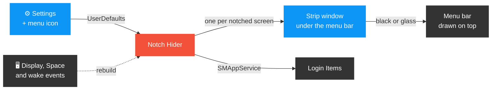

<h1 align="center">⬛ Notch Hider</h1>

<p align="center"><b>Paints your MacBook's menu bar true black, so the notch disappears into it.</b></p>

<p align="center">
  
  
  
  
  
  
</p>

---

## ✨ What's inside

| | Feature | | Feature |
|:-:|---|:-:|---|
| ⬛ | **True black**: every pixel RGB 0, verified | 🧊 | **Blurred glass**: 1–100% strength |
| 🔲 | **Round corners**: 0–20 pt slider | 🖥️ | **Notched screens only**: externals untouched |
| 🚀 | **Launch at login**: native Login Items | 👻 | **Hideable icon**: reopen app for settings |
| 🔄 | **Follows changes**: displays, Spaces, wake | 🧪 | **Tested**: unit + live pixel checks |

---

## 🗺️ How it fits together



---

## 🚀 Quick start

Needs a Mac with a notch and Xcode or the Command Line Tools (`xcode-select --install`).

**1. Build and install** (runs the tests, copies the app to `~/Applications`, starts it)

```sh
git clone https://github.com/NiZZioN/NotchHider.git && cd NotchHider
./install.sh --login        # --login turns on Launch at login; --dest /Applications to install elsewhere
```

**2. Configure:** click the menu bar icon → **Settings…** (or open Notch Hider again if you hid the icon).

**3. Uninstall**

```sh
./uninstall.sh              # removes the login item, the app and its settings
```

| 🧪 Unit tests | 🎯 Live black check | 🔁 Live restyle check |
|:-:|:-:|:-:|
| `./test.sh` | `./verify-live.sh` | `./verify-restyle.sh` |

The live checks capture the real strip window as 16-bit float pixels and require exactly RGB 0. They need Screen Recording permission for your terminal; `verify-live.sh` restarts the app twice and restores your settings.

---

📚 [Source](Sources) · [Tests](Tests) · [Info.plist](Info.plist) (change `CFBundleIdentifier` there for your own fork) · [MIT License](LICENSE)
