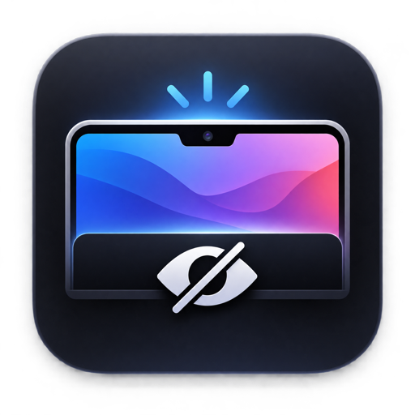
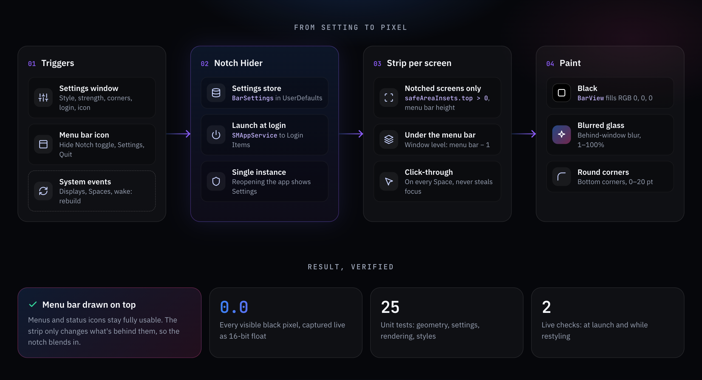

<p align="center">
  
</p>

<h1 align="center">Notch Hider</h1>

<p align="center"><b>Paints your MacBook's menu bar true black, so the notch disappears into it.</b></p>

<p align="center">
  
  
  
  
  
  
  <a href="https://github.com/NiZZioN/NotchHider/actions/workflows/ci.yml"></a>
</p>

---

## ✨ What's inside

| | Feature | | Feature |
|:-:|---|:-:|---|
| ⬛ | **True black**: every pixel RGB 0, verified | 🧊 | **Blurred glass**: 1–100% strength |
| 🔲 | **Round corners**: 0–20 pt slider | 🖥️ | **Notched screens only**: externals untouched |
| 🚀 | **Launch at login**: native Login Items | 👻 | **Hideable icon**: reopen app for settings |
| 🔄 | **Follows changes**: displays, Spaces, wake | 🧪 | **Tested**: unit + live pixel checks |

---

## 🗺️ How it fits together

<p align="center">
  
</p>

<p align="center"><sub>Interactive version with a live Off / Black / Glass preview: open <a href="docs/architecture.html"><code>docs/architecture.html</code></a> in a browser.</sub></p>

---

## 🚀 Install

Needs a Mac with a notch (Apple silicon) on macOS 13 or later.

**1. Homebrew** (recommended)

```sh
brew install --cask nizzion/tap/notchhider
```

**2. One line** (builds from source; needs the Command Line Tools, which it offers to install)

```sh
curl -fsSL https://raw.githubusercontent.com/NiZZioN/NotchHider/main/get.sh | zsh
```

**3. From a clone**

```sh
git clone https://github.com/NiZZioN/NotchHider.git && cd NotchHider
./install.sh --login        # --login turns on Launch at login; --dest /Applications to install elsewhere
```

Then open **Settings…** from the menu bar icon (or open Notch Hider again if you hid the icon).

| | Homebrew | One line | Clone |
|---|---|---|---|
| ⬆️ Update | `brew upgrade --cask notchhider` | run it again | `git pull && ./install.sh` |
| 🗑️ Uninstall | `brew uninstall --cask notchhider` | `… \| zsh -s -- --uninstall` | `./uninstall.sh` |
| 📍 App location | `/Applications` | `~/Applications` | `~/Applications` |

---

## 🧪 Development

| 🧪 Unit tests | 🎯 Live black check | 🔁 Live restyle check | 📦 Release build |
|:-:|:-:|:-:|:-:|
| `./test.sh` | `./verify-live.sh` | `./verify-restyle.sh` | `./release.sh` |

- **CI** runs the unit tests and builds the app on every pull request and on `main`. `main` is protected: changes land only through pull requests with a green CI run.
- **Releases**: bump `CFBundleShortVersionString` in `Info.plist`, merge, then push a matching tag (`git tag v1.2.0 && git push origin v1.2.0`). The release workflow tests, builds and publishes the zip plus a ready Homebrew cask; the [tap](https://github.com/NiZZioN/homebrew-tap) picks it up automatically.
- The live checks capture the real strip window as 16-bit float pixels and require exactly RGB 0. They need Screen Recording permission for your terminal, so they run locally, not in CI.

---

📚 [Source](Sources) · [Tests](Tests) · [Info.plist](Info.plist) (change `CFBundleIdentifier` there for your own fork) · [MIT License](LICENSE)
